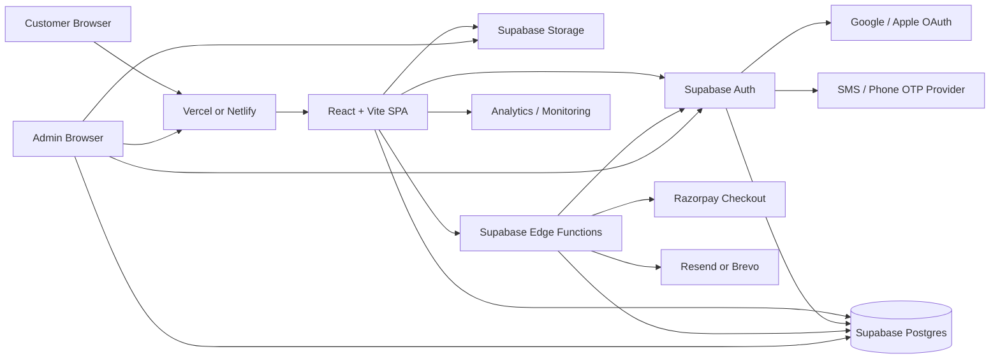

# BleedPrints Architecture

## System Diagram

## Runtime Notes

- The storefront is a client-rendered React SPA deployed behind static hosting with SPA rewrites.
- Product, collection, order-history, and admin CMS data are stored in Supabase Postgres and read through the public client.
- Customer auth uses Supabase Auth with email/password, phone OTP, Google OAuth, and Apple OAuth entry points.
- Product images are served from Supabase Storage.
- Checkout creates and verifies orders through Supabase Edge Functions before completing Razorpay payment.
- The in-app admin studio writes directly to the same Supabase catalog tables used by the storefront.

## Operational Responsibilities

- Hosting:
  - static deployment
  - environment variables
  - SPA rewrite rules
- Supabase:
  - auth providers
  - database schema and RLS
  - storage bucket and policies
  - edge function deployment
- Payments:
  - Razorpay credentials and enabled payment methods
- Notifications:
  - transactional email provider hookup
- Observability:
  - analytics, error tracking, uptime checks

## Napkin Note

- A Mermaid source is checked in here so the architecture stays versioned with the repo.
- If you want a polished visual in Napkin, use this Mermaid diagram or the runtime notes above as the input brief.
- I did not wire Napkin API generation into the app or build pipeline because it is not required for deployment readiness and should stay optional to the delivery flow.
